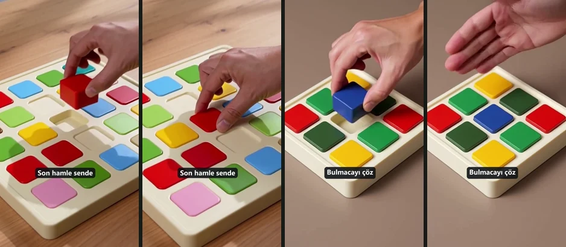

# UGC Creator

A local video creator for product-aware, audience-specific UGC. Its director connects a supported product fact to a real desire, chooses an opening action and specifies the visual proof. Give Studio a brief or upload a reference. It plans shots, renders alternatives, checks decoded frames, typesets captions, and keeps a ranked cut with the evidence behind it. The browser interface is in Turkish. Briefs and captions support Turkish and English.



[Getting started](docs/getting-started.md) · [Turkish guide](docs/baslangic.md) · [Research and evaluation](docs/research.md) · [RTX 3090 example](docs/rtx-3090-evaluation.md)

## Start the studio

Install Python 3.11+ and FFmpeg with H.264 support. Windows users can double-click `Start-UGC-Creator.cmd` after cloning. On Linux install DejaVu Sans and a working system keyring to store account tokens, or supply credentials through environment variables.

```sh
git clone https://github.com/oguzhanozfe/ugc-creator.git
cd ugc-creator
python -m venv .venv
# Linux / macOS
source .venv/bin/activate
# Windows PowerShell
# .\.venv\Scripts\Activate.ps1
python -m pip install -e .
framecraft studio
```

Open [Studio on localhost](http://127.0.0.1:7865). **Analyze** (Analiz) works on CPU immediately. Upload an MP4 and open its frame evidence. Pick **Create from this reference** (Bu referansla üret) to carry its editorial breakdown into a new brief. In **Create** (Üretim), choose an aspect ratio and up to ten variants. Each shot lasts about three seconds. The default three-shot cut runs about nine seconds. The Studio master uses 24 fps H.264. Silent output is selected by default in the browser.

For a real game capture or product demo, select a completed reference and choose **Use the original footage** (Bu çekimin gerçek görüntülerini kullan). Studio chooses moving sections from the supplied footage, preserves its framing, and typesets and audits the resulting cut. This mode also works without a generator.

To revise a rendered creative, open its job, choose a source variant in **Revise this edit** (Bu kurguyu revize et), and describe the change. The vision model describes frames from that cut. The text director uses those observations and your change request to write fresh shot prompts and visible acceptance criteria. Studio checks for repeated shots and asks the model to check the plan for contradictions before rendering. A rejected plan gets one rewrite. A failed check triggers one new attempt informed by the evidence. A revision needs a working vision model to qualify as a winner. If the vision service missed a verdict, **Retry** (Yeni deneme başlat) can reuse the previous model footage, recheck its pixels, and regenerate a shot when the new evidence calls for it. The original cut stays available. API clients can POST `{"changes":"…","variant":1,"variants":2}` to `/api/jobs/{job}/revise` with the `X-Framecraft: 1` header. Omit `variant` to use the source winner and `variants` to inherit its batch size.

## Connect a renderer

Open **Connections** (Bağlantılar). Studio checks the actual node types and model filenames advertised by ComfyUI. It reports missing components and the GPU memory class. Initial ranks are explicit priors. Completed local runs supply scores, pass rates and wall-clock measurements.

| Renderer | Setup |
| --- | --- |
| Wan 2.2 TI2V-5B | The same native graph supports text and reference images. Studio installs the diffusion model, UMT5 encoder and VAE with SHA-256 verification. The published ComfyUI workflow uses 20 UniPC steps. [Official workflow and model files](https://docs.comfy.org/tutorials/video/wan/wan2_2) |
| MiniMax H3 | Start ComfyUI with H3 nodes. The default URL is `http://127.0.0.1:8188`. Set the ComfyUI models directory and use **Install model files** (Model dosyalarını kur) to install the INT8 diffusion model, Qwen encoder, both VAEs and the 8-step Turbo LoRA. |
| LTX 2.5 | Install the [CCTech loader](https://github.com/ChrisColeTech/ComfyUI-GGUF-Loader) in ComfyUI. The installer downloads ChrisColeTech's scaled FP8 weights, GGUF text encoder and projector, and audio/video VAEs. |
| Standalone H3 | Point the standalone directory at a [stable-diffusion.cpp](https://github.com/leejet/stable-diffusion.cpp) install with `runtime/sd-cli.exe`, `sd-cli.exe` or `sd-cli`, and the four [quantized H3 files](https://huggingface.co/unsloth/MiniMax-H3-GGUF) named in `framecraft/providers.py` under `models/`. It renders directly with CPU text-encoder offload. |

The download installer pins the Hugging Face revision returned for that install and verifies every SHA-256. Model weights and licenses stay with the original publishers. A configured Civitai token enables gated downloads that the account already has access to. Search results expose base family, trigger words, example prompts when supplied, and seller permissions. Optional automatic matching downloads a compatible H3 SafeTensor with the commercial image permission and records its provenance. The H3 Turbo adapter is applied even when creative adapter discovery is disabled.

## Director and quality control

Studio discovers a local OpenAI-compatible endpoint at `http://127.0.0.1:1234/v1`. LM Studio, a compatible gateway or a hosted text/vision service can be selected under **Connections** (Bağlantılar). A configured remote service receives the brief, relevant OCR and selected keyframes. The video renderer can remain local. Model-directed generations require a working director. The source-footage editor can use a local storyboard when the director is offline. The explicit offline storyboard mode remains available with `FRAMECRAFT_DIRECTOR=off` for fresh briefs. Revisions always require model direction. Video analysis records unavailable semantic reviews.

1. The director builds an opening, demonstration and CTA with short captions. A reference contributes observations and pacing. Each variant gets a creative angle and independently drawn seeds.
2. For ComfyUI, the sampler monitor reads available late-step previews. Two consecutive suspect steps can cancel the specific prompt through the job-scoped API. Preview support varies by backend and model. H3 and LTX decode final frames in batches. Each completed shot gets a full audit before the next shot begins.
3. The CPU audit reads **every decoded frame** with its presentation timestamp. RapidOCR records visible text, confidence and bounding boxes. Other signals include exposure, motion, cuts, focus and frozen sequences. A vision model assesses contact sheets for composition, anatomy, continuity and brief alignment. Failed shots get one targeted retry.
4. Authored captions are checked against an offline Turkish or English spelling dictionary, with words from the brief and shot terminology allowed. The copy editor gets a correction attempt for unrecognized wording. Captions are typeset as Unicode plates. Final QA compares the expected cue with OCR and checks actual glyph pixels, including Turkish accents, against the rendered plate. A caption defect triggers a new edit and another full scan. Individual frame records remain available in JSONL.
5. Passing variants are ranked by final technical quality, shot quality and vision alignment when available. If all variants fail, the job returns **Needs review** (İnceleme gerekli) with its findings. Individual drafts and failed attempts remain inspectable. Technical ratings describe this render. CTR and conversions come from campaign measurements.

Reference analysis includes shot timing, recurring text, measured audio levels and an optional visual breakdown with evidence, inferred audience, hook and improvements. Install `pip install -e '.[speech]'` and select a Whisper model or local model directory for timestamped dialogue transcription. For a standalone caption audit, pass a JSON array of `{"start":0,"end":2,"text":"Son hamle sende"}` cues.

## Publishing and learning

Review the winning cut in Studio. Use **Connections** (Bağlantılar) to sign in with a registered TikTok Desktop or Meta app, or paste provider-issued tokens. Register the matching localhost redirect, e.g. `http://127.0.0.1:7865/auth/tiktok/callback` or `http://127.0.0.1:7865/auth/meta/callback`. TikTok uses desktop PKCE and refresh token rotation. For Meta choose the connected Page after login. Secrets go to the OS keyring. Environment variables also work for headless use. The same video can be submitted once per destination. Remote IDs and submission state are persisted. Use **Check status** (Durumu sorgula) to reconcile platform processing. A network failure after submission stays marked for reconciliation.

- **TikTok Direct Post** uses a creator token with `video.publish`, current creator settings, the selected visibility, disclosures, media consent and chunked upload. Public distribution requires TikTok client audit. [Developer guidelines](https://developers.tiktok.com/doc/content-sharing-guidelines/)
- **Facebook Reels** uses a Page access token and Page ID for start, upload and finish. **Meta Ads video library** uses an ads-capable token and ad account ID to upload the winning asset. Media library upload creates a video asset. Campaigns, budgets and ad sets are managed in Ads Manager. [Facebook Reels API](https://developers.facebook.com/docs/video-api/guides/reels-publishing/) · [Ad videos](https://developers.facebook.com/docs/marketing-api/reference/ad-account/advideos/)
- Import a specific ad and reporting window from Meta Ads Insights with `ads_read`, or enter cumulative impressions, clicks and conversions for a variant. Totals replace previous observations. After 100 impressions for an angle, a smoothed click-through rate affects future angle order. This small local history can reflect audience and placement differences.

The archive also accepts two to ten existing imports or exported variants for a fresh comparison against a common brief. The comparison job rechecks frames, preserves the source exports and records the score and rejection reasons for each entry.

## Agent API

Interactive endpoints are at [local OpenAPI docs](http://127.0.0.1:7865/docs). Codex, Claude and other clients can call the same HTTP interface as Studio. Send `X-Framecraft: 1` on writes. Bind the single worker to loopback. Jobs and SQLite history live under `~/.framecraft` or `FRAMECRAFT_HOME`.

```sh
curl -X POST http://127.0.0.1:7865/api/create -H 'X-Framecraft: 1' -H 'Content-Type: application/json' -d '{"brief":"A tabletop puzzle. Show the last move.","language":"en","variants":2,"shots":2}'
curl -X POST http://127.0.0.1:7865/api/analyze -H 'X-Framecraft: 1' -F video=@reference.mp4
framecraft models
framecraft analyze reference.mp4 --out audit
framecraft create "One final puzzle move" --variants 2 --shots 2 --language en
```

Poll `GET /api/jobs/{id}` for progress, analysis, ranking, artifact paths and delivery status. Fetch an artifact at `/api/jobs/{id}/files/{path}`. JSONL keeps timestamps for offline analysis. For CLI automation, use a separate `FRAMECRAFT_HOME` when running multiple workers on different GPUs.

## Thirty-second Turkish campaigns

Paste an Amazon Türkiye product URL or an Apple App Store game URL into the first form in Studio. You can supply the project name, audience and creative direction. The director plans an opening action and a visible detail from the listing. The default product shoot follows the creator's own phone through four connected angles. Game campaigns use actual gameplay. Studio saves the reviewed edit in the project library. For the same product shoot through `POST /api/campaign`, send a JSON `url`, `"camera":"handheld"` and `"audio":"voice_music"` with the local `X-Framecraft: 1` header. Store lookup requires internet access.

Studio groups saved videos in **Projects** (Projeler). Give a brief a project name to keep revisions together. A completed iteration is stored at `FRAMECRAFT_HOME/projects/Project Name/Project Name - UGC 001/Project Name - UGC 001.mp4`. Open `projects/index.html` for an offline library. The same video in the same project keeps its iteration number on retry.

The listing form defaults to an instrumental mix. Choose Turkish narration to add a named voice. For the warm female voice, install `pocket-tts-turkish` in an isolated Python environment and set its interpreter in **Connections** (Bağlantılar) in the Turkish Pocket TTS interpreter field (Pocket TTS Türkçe Python yolu). The API accepts `"audio":"voice_music","voice_profile":"pocket/female_2"`. The project stores the selected voice in the narration receipt. The two female presets come from [WiteTech’s Pocket TTS Turkish](https://huggingface.co/wite-tech/pocket-tts-turkish), derived from Kyutai Pocket TTS under CC BY 4.0. Freya remains available through its own runtime. Install the ACE-Step 1.5 Turbo AIO checkpoint in ComfyUI for music.

For music alone, send `"audio":"music"` or supply `"audio_mode":"music"` and `"score"` in a motion recipe. To re-score a reviewed master while copying the exact video stream, run `python -m framecraft.campaign_remix motion.json score.flac music-edition`. Use `"audio":"silent"` for silent output. To retain approved portions during a visual revision, `campaign_remix.approved_shot` accepts the prior recipe, zero-based shot index, offset, duration and new working directory. The renderer checks the source fingerprint and time span and can make a five-frame dissolve before drawing the incoming text.

Install `pip install -e '.[campaign,speech,product-stage]'`. Connect the H3 ComfyUI renderer and a local language model in Studio. The campaign runner produces vertical, 1080 × 1920, 30 fps edits. It accepts moving source footage and reference-conditioned product takes. Every source interval must be long enough for its shot and may appear only once.

Create a campaign directory with a `campaign.json` manifest. For example:

```json
{"items":[{
  "slug":"graphics-card","kind":"product","id":"B0F8KJKC9Y",
  "name":"ASUS Dual GeForce RTX 5070 OC","audience":"1440p monitörle oynayan PC oyuncusu",
  "angle":"Kompakt bir kasada çift fanlı kartın yerleşimini göster.",
  "proof":"ASUS teknik sayfası iki fan ve 12 GB GDDR7 bellek bildiriyor.",
  "limits":"Test kaynağı verilmeden performans sonucu kullanma.",
  "gallery":[{"photo":1}],"asr_model":"models/whisper-small"
}]}
```

Set `FRAMECRAFT_VOICE_PYTHON` to a Python interpreter with [FreyaTTS](https://github.com/freyavoiceai/FreyaTTS) and its VoxCPM AudioVAE dependencies installed. `FRAMECRAFT_FREYA_SOURCE` can point at a local Freya source checkout. `FRAMECRAFT_FREYA_MODEL` accepts a downloaded weights directory. Set `FRAMECRAFT_VOICE_DEVICE` to `cpu` to reserve VRAM for rendering.

Run `framecraft-campaign PATH_TO_CAMPAIGN run`. Use `--only ITEM_SLUG` for a single cut. The `prepare` stage produces the local director's script and voice. A game item uses `kind: game` and a mobile App Store ID. Set `portrait_game` for vertical gameplay. A custom cut can supply a `motion_recipe` path relative to its item directory.

A motion recipe contains a `voice` WAV and an array of `shots`. Each shot names a `file`, source `start` time and `seconds`. Optional graphic fields are `eyebrow`, `headline`, `detail` and `credit`. The shot durations must sum to thirty seconds. A `score` adds a local music file that ducks under narration. Use `python -m framecraft.campaign_score score.flac "instrumental direction"` with ComfyUI's ACE-Step 1.5 Turbo AIO checkpoint to generate an original score. Render an independent recipe with `framecraft-motion path/to/motion.json`.

For a reconstructed product, `python -m framecraft.product_stage product.glb views.jpg` renders an eight-angle inspection sheet from actual geometry. Supply `--shots camera-paths.json` and an output directory to render moving camera shots. UGC Creator keeps source credits, reads text in each decoded frame, tests for repeated moving sequences and frozen images, and compares the mixed voice with the intended copy when an ASR model is configured. A passing report is bound to the MP4 by its SHA-256 digest. Source-media reuse rights require separate verification for paid distribution.

For a creator-led edit, render an opening take with H3 and run `python -m framecraft.campaign_presenter cast.json yunet.onnx`. The cast plan names the `opening` video and a list of `shots` with `file`, `prompt` and `seconds`. UGC Creator finds a clear face in the opening and conditions subsequent takes on that frame. Camera direction, wardrobe and location belong in each shot prompt.

To synchronize the face with recorded speech, use an isolated Python environment with PyTorch, diffusers, transformers, OpenCV and NumPy. Run `python framecraft/campaign_dub.py dub.json WEIGHTS MUSETALK_CHECKOUT`. The local weights directory contains `musetalkV15/`, `sd-vae/`, `whisper/` and `yunet.onnx`. Each entry in `clips` names its source `file`, source `start`, start on the narration `timeline`, duration in `seconds` and `output`. The top-level `voice` names the WAV. The tracker reports how many frames contain the presenter's face. See the [MuseTalk model and weight instructions](https://github.com/TMElyralab/MuseTalk).

Place the synchronized takes in the motion recipe. A shot can use `layout` values `clean`, `corner`, `side`, `tag`, `metric` or `versus`. For two measured results, set `comparison` to their numeric values and include the units, test conditions and source in the text fields. Put a moving face camera or product insert in an `inset` with its own `file`, `start`, `x`, `y`, `width` and `height`. An optional `preview_seconds` renders a short audition using the same frame and audio checks. Store its recipe in a separate directory to retain the full edit's assessment.

### Matched creative tests

Use one approved 30-second motion recipe per product. The opening and closing are direct-to-camera takes. The middle shots retain the reviewed source intervals. Each hook is paired with two different spoken and captioned calls to action. Keep the audience, opening, music and product evidence fixed within each pair. An optional `segments.json` in the product directory can describe the audience and test hypothesis for each opening. Order its entries by hook and include the exact `hook_text`, `audience` and `hypothesis`.

An experiment catalog contains a `products` list. Each entry names a `slug`, `project`, integer `hooks`, source `base` recipe, `score`, local Whisper directory `asr`, `voice`, and a `middle_speech` mapping of narration keys to start times in seconds. Resolve these paths relative to the catalog. Inside each slug directory, `final-copy.json` contains `hooks`, `ctas`, and the middle narration strings. The `speech` folder holds mono 24 kHz PCM16 WAVs, matching `hook0-face.mp4` and `cta0-face.mp4` takes, and corresponding `*-sync.json` measurements bound to the speech and video hashes. Use zero-based indices for the input takes.

To generate mouth motion from the recorded voice, set `presenter.opening` and `presenter.closing` for each product to objects with a source `file`, `start` and `seconds`. Place each Turkish reading's spoken text, including expanded numbers and abbreviations, in `speech/creative-ready.json` under `readings.KEY.spoken`. Keep the original, unmixed dialogue stems. Two other recordings by the same speaker provide negative controls.

In the isolated CPU face runtime, run `pip install -e '.[face-review]'` from the repository. Set `FRAMECRAFT_FACE_PYTHON` to its Python executable, `FRAMECRAFT_FACE_MODEL` to the Face Landmarker task, and `FRAMECRAFT_SPEECH_ANCHORS` to the Turkish model directory. The latter contains `config.json`, `vocab.json` and the quantized ONNX file saved as `model.onnx`. Optional Rhubarb phonetic cues can drive a local repair of individual mouth poses. [MediaPipe Face Landmarker](https://ai.google.dev/edge/mediapipe/solutions/vision/face_landmarker) · [Turkish acoustic weights](https://huggingface.co/onnx-community/wav2vec2-large-xlsr-turkish-ONNX)

In the MuseTalk environment, run `python -m framecraft.campaign_cast experiments.json WEIGHTS MUSETALK_CHECKOUT SYNCNET_DIR`. For a second renderer, save its configuration as `models/latent-sync.json` under your Framecraft home or pass `--diffusion-config latent.json`. Its JSON keys `repo`, `checkpoints`, `vae` and `model_python` point to your LatentSync checkout, checkpoints, Diffusers VAE and isolated model Python. An optional `work_dir` reuses source tracks. Resolve paths relative to the JSON file. The fallback rerenders the original performer from the original WAV and applies the same checks. [LatentSync](https://github.com/bytedance/LatentSync)

1. Run `python -m framecraft.campaign_experiments experiments.json` to render and audit the editions.
2. In the lip-sync environment, install `python_speech_features` and supply the local YuNet detector and the directory containing `SyncNetModel.py` and `syncnet_v2.model`. Run `python -m framecraft.campaign_experiments experiments.json --verify-lips yunet.onnx SYNCNET_DIR`. The final MP4 is decoded again. Checks cover timing, Turkish vowel openings and lip closures, movement during pauses, discrimination from other recorded lines, and changes in the lips, cheeks and chin, including loss of visible lip colour during closure. The mix is checked separately against the timed narration. A failed or inconclusive final check prevents export. [SyncNet source and weights](https://github.com/joonson/syncnet_python)
3. Run `python -m framecraft.campaign_experiments experiments.json --export gallery` to package the MP4s, comparison page, CSV and manifest. Add `--ready-only` to review completed pairs during a run.

To check that a pair plays alike up to its closing, run `python -m framecraft.campaign_pairqa A.mp4 B.mp4 FIRST_CLOSING_FRAME pair.json`. The report measures frame differences, mixed-audio correlation and level drift before the closing, and checks for a visible change during the closing.

### Product print

To recover an authentic detail from an existing moving take, run `python -m framecraft.motion_reframe source.mp4 detail.mp4 4 "a hand choosing a blazer from the rail" --model VISION_MODEL`. The local reviewer ranks candidate views against the requested action. The selector checks continuous movement, anatomy and subject visibility and records which portion of the source it used.

A close-up of a round bottle can use its original printed label. Supply a clean front photograph on white to `python -m framecraft.bottle_asset front.jpg bottle.glb` and render a shallow front camera move with `framecraft.product_stage`. This reconstruction estimates the visible circular profile. It supports front views of approximately ±15 degrees. For a shot that must keep a package phrase legible, run `python -m framecraft.campaign_print front.jpg shot.mp4 print.json "SEA SALT"`. The report and frame ledger identify which frames reproduce the reference wording.

For a small inscription on a curved surface, run `python -m framecraft.reference_detail product.jpg "Brand Name" depth-small.onnx detail.glb`. The tool locates the exact words in the catalog photograph, uses the local Depth Anything model to estimate the visible surface and maps the original lettering onto that surface. Use a shallow camera orbit over the photographed side. Check the encoded result with `campaign_print --start 16 --seconds 5` and the reference, video, report and phrase arguments shown above.

An optional `required-print.json` array in a product directory binds these checks to gallery export. Each entry names the variant-relative `report`, expected `phrase`, `reference_sha256`, `start_frame`, `frames` and `minimum_fraction`. Export verifies the report against that edition's MP4 and the exact interval.

For a material close-up, run `python -m framecraft.campaign_detailqa detail.mp4 detail.json review.json --source-facts source.json --model VISION_MODEL` with the mesh receipt from `reference_detail`. The checker follows matching features from the original photograph across every video frame. The visual reviewer compares the same part of the product at a similar scale and checks it against the catalog description. A product-level `required-picture.json` can point to an approved master report via its `report` field to prevent previous source cuts from replacing the selected edit.

## Development

```sh
python -m pip install -e '.[test]'
python -m pytest -q
```

See the [research and evaluation notes](docs/research.md) for design sources, thresholds, model selection and limitations. MIT license for Studio code.

